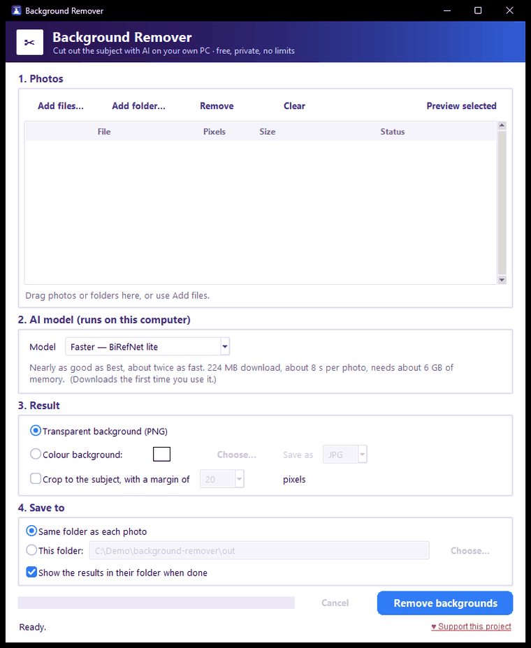

# Background Remover

**Free, offline alternative to paid background removers. No credits, no watermark, no uploads.**



Cuts the subject out of photos (people, pets, products) and saves a **transparent PNG**, or puts
it on a **colour of your choice**. Batches of any size, with drag and drop. The AI runs on your
own computer, so your photos never leave it. Works on Windows and macOS.

## Download
Get the latest version from the [Releases page](https://github.com/collinb0607/background-remover/releases/latest).

| Your computer | Download | First launch |
|---|---|---|
| Windows 10/11 | `Background-Remover-Windows.exe` | Windows may show "Windows protected your PC" because the app isn't signed. Click **More info**, then **Run anyway**. The first start takes a few seconds. |
| Mac with Apple Silicon (M1 or newer) | `Background-Remover-macOS.zip` | Unzip, then open **Background Remover**. macOS blocks it the first time because the app isn't notarized: open **System Settings → Privacy & Security**, scroll down and click **Open Anyway**. |

On an Intel Mac, or any other system, run it from source with Python (below).

**The AI model downloads once.** The first time you use a model, the app asks to download it
(179 MB to 973 MB, from the [rembg](https://github.com/danielgatis/rembg) project's releases on
GitHub). After that everything works offline. Models are kept in `~/.rembg/models`
(`C:\Users\<you>\.rembg\models` on Windows), the same place rembg keeps them, so they're shared.

## Choosing a model
All three run on the CPU; no graphics card needed. Times are for a 12-megapixel photo on a recent PC.

| Model | Download | Time per photo | Memory | Best for |
|---|---|---|---|---|
| **Best quality — BiRefNet** | 973 MB | about 15–20 s | about 8 GB | The cleanest edges on hair, fur and cluttered backgrounds. |
| **Faster — BiRefNet lite** | 224 MB | about 10 s | about 6 GB | Nearly as good as Best. The default on computers with 12 GB of memory or more. |
| **Fast, low memory — IS-Net** | 179 MB | about 2 s | under 1 GB | Simple photos: products, plain backgrounds. Struggles with hair and busy scenes. The default on computers with less memory. |

Not sure? Select a photo and click **Preview selected** (or double-click it) to see the cutout
before saving the batch. If the edges look wrong, try another model.

## How it works
- **Drag and drop.** Drop photos or whole folders anywhere on the window (a folder adds the
  photos directly inside it), or use **Add files** / **Add folder**. JPG, PNG, WebP, HEIC (iPhone),
  BMP and TIFF.
- **Before/after preview.** Shows the original and the result side by side, with transparency as
  a checkerboard. A previewed photo isn't processed twice when you save the batch.
- **Clean edges.** Where the subject is partly see-through (hair, fur, soft edges), the app
  estimates the subject's own colours, so the old background doesn't show as a coloured fringe
  on the new one. Inside the subject, nothing is see-through.
- **Colour background.** White or any colour from a colour picker, saved as JPG or PNG. Handy for
  product listings and profile pictures.
- **Crop to the subject.** Trims the empty space around it, with a margin you choose.
- **Safe with your files.** Results are new files next to the original (or in a folder you pick):
  `dog.jpg` becomes `dog (no background).png`, or `dog (new background).jpg` with a colour. If they
  already exist it asks once for the whole batch: replace, skip those, or stop. Each file is
  written under a temporary name and renamed when finished, so Cancel never leaves half a file.
- **Private.** Results contain no camera or location data. Photos are turned upright first, and
  their colour profile is kept.

## Run from source (Python)
### Setup (one time)
1. Install **Python 3.8+** from https://python.org. On Windows, tick **"Add Python to PATH"** during install.
2. Run the app (see below). The first time, it asks to install **numpy** and **onnxruntime** (to run
   the AI model), **Pillow** and **pillow-heif** (images, including HEIC), **certifi** (for the model
   download) and **tkinterdnd2** (drag and drop). Click **Yes**; it's about a 50 MB download.

### Run
```
python background_remover.py        # Windows
python3 background_remover.py       # macOS
```
On Windows you can also double-click `background_remover.py`. If you have more than one Python
installed, double-clicking can run a different one from `python` in a terminal, so it may ask to
install the components once more. The install dialog shows which Python it installs into.

## Troubleshooting
- **"Not enough memory":** use **Fast, low memory — IS-Net**, or close other programs. The BiRefNet
  models need several GB free while a photo is processed.
- **Part of the background is kept, or part of the subject is cut away:** try another model in
  **Preview**. BiRefNet handles cluttered scenes much better than IS-Net.
- **The model download fails:** check your internet connection and try again. A failed or
  cancelled download is never used. You can also place the model file yourself in
  `~/.rembg/models/<model name>/` (for example `isnet-general-use/isnet-general-use.onnx`).
- **Something fails with no message:** errors are also written to `background_remover_errors.log`
  in your temp folder. On Windows, paste `%TEMP%\background_remover_errors.log` into File Explorer's
  address bar. On Mac, run `open $TMPDIR/background_remover_errors.log`.

## Credits
The AI models are [IS-Net](https://github.com/xuebinqin/DIS) (Apache 2.0) and
[BiRefNet](https://github.com/ZhengPeng7/BiRefNet) (MIT), as converted and published by
[rembg](https://github.com/danielgatis/rembg) (MIT), whose way of running them this app follows.

## Part of the Offline Toolkit
Also by me: [GIF Maker](https://github.com/collinb0607/gif-maker),
[Video Compressor](https://github.com/collinb0607/video-compressor),
[Audio Converter](https://github.com/collinb0607/audio-converter) and
[Image Converter](https://github.com/collinb0607/image-converter): free, offline replacements for
websites that cap your file size, add a watermark, or want a subscription.
